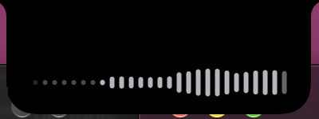
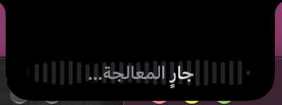
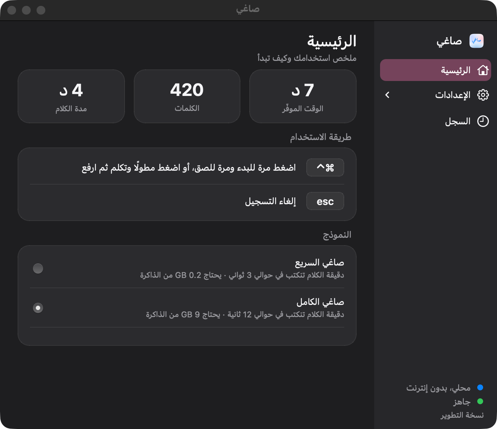
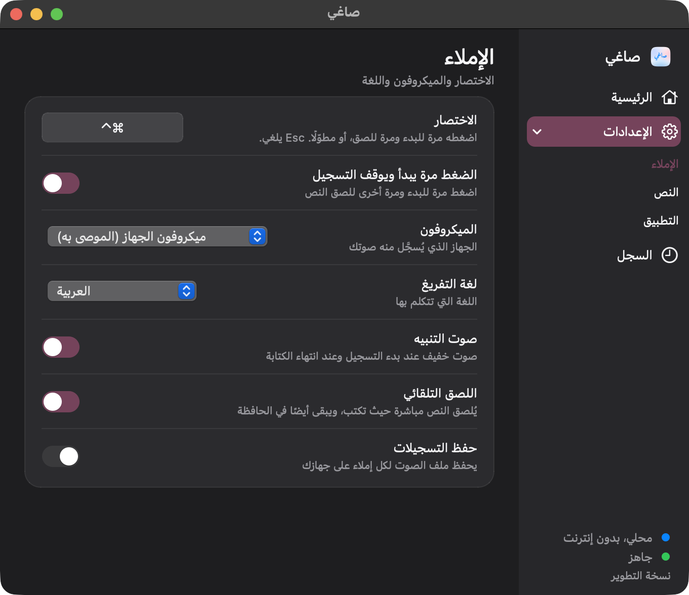

# Saghi-mac

Free Arabic voice typing for Apple-silicon Macs. It runs fully offline, on your Mac. Your voice never leaves the device.

Tap your shortcut, speak Arabic, tap it again. Saghi-mac turns your speech into clean text and pastes it where you were typing. It lives in your Mac's notch: no window in the way, no menu-bar icon.

## Requirements

- A Mac with Apple silicon (M1 or newer). Intel Macs are not supported.
- macOS 13 (Ventura) or newer.
- About 11 GB of free disk space while installing (the app takes about 5 GB afterwards).
- 8 GB of RAM or more is recommended.

## Install

1. Open the latest release: https://github.com/alpha2xyz/Saghi-mac/releases/latest
2. Download `Install-Saghi-mac.zip` from the release assets, then double-click it to unzip. You get `Install-Saghi-mac.command`.
3. Double-click it. The first time, macOS Gatekeeper will block it because it is not signed:
   - macOS 15 (Sequoia) or newer: double-click the file, then open System Settings, Privacy & Security, scroll down and click **Open Anyway**, then confirm.
   - macOS 13 or 14: Control-click the file, choose **Open**, then click **Open** again.
   - If macOS says the file "could not be executed because you do not have appropriate access privileges", open Terminal and run: `bash ~/Downloads/Install-Saghi-mac.command`
4. The installer downloads the app (about 4.8 GB, in 3 parts), checks it, and installs Saghi to `~/Applications/Saghi.app`. It needs an internet connection only for this step. No admin password is needed.
5. It asks if you want Saghi to start at login (default: no).

To install a specific version, run the installer with `SAGHI_RELEASE_TAG=v0.1.0`.

## Permissions

macOS asks for these the first time you use each feature (System Settings, Privacy & Security):

| Permission | Why |
|---|---|
| Microphone | To record your voice. |
| Input Monitoring | To detect the global shortcut from any app. |
| Accessibility | To paste the text into the active app, and to keep a one-key shortcut (like §) from also typing its character. |

Look for **Saghi** in each list and switch it on. If you see `python3.12` instead, switch that one on.

## Usage

1. Click into any text field: browser, Notes, WhatsApp, Word, anything.
2. Tap the shortcut once and speak. The default is **Control + Command**. Tap it again when you are done: the text is cleaned (hesitation sounds removed) and pasted, and it is also kept on the clipboard.
3. Or hold the shortcut while you speak and let go to finish, if you prefer push-to-talk.
4. Press **Esc** at any time to throw the recording away.

**Any shortcut you like.** In Settings, Dictation, click the shortcut box and press the key or keys you want: one key (for example **§** or **F5**, or the right **Option** key alone), two modifiers, or a modifier plus a key (for example **Command + Space**). A one-key shortcut that normally types a character is kept from typing while Saghi uses it. Tap-to-toggle can be switched off if you only want hold-to-talk.

Open **Settings, App, Transcribe an audio file** to transcribe audio or video files (WAV, MP3, M4A, AAC, FLAC, OGG, MP4). Long files are processed in safe chunks and progress is saved, so a stopped job resumes where it left off. You can export plain text, SRT or WebVTT.

The **History** page keeps what you dictated. You can search it, copy, export an entry as a text file, delete one entry, or clear everything from Settings, App. Settings can also delete entries older than 7, 30 or 90 days automatically.

### The notch

Saghi sits in the notch at the top of the screen and is invisible until you dictate. When you start, the notch springs open and a row of dots scrolls along: each dot grows into a bar as loud as your voice was at that moment, and stays a flat dot in silence. When you stop it shows "processing", then folds back into the notch. Click the notch to open Saghi's window. On Macs without a notch the same shape appears at the top centre only while you dictate.

Saghi plays its own soft sounds when recording starts, stops, or is thrown away (you can turn them off).

### The window

- **Home:** time saved, words dictated and time spoken, a reminder of your shortcut, and the speech model. Two are included, and you pick one: **Saghi Fast** (default): about 3 seconds per minute of speech, lighter on the Mac; and **Saghi Full**: closer to the original model, about 4 seconds per minute of speech. Both are GGUF quantizations of the same model (Fast is Q6_K, Full is Q8_0). A change applies after a restart.
- **Settings,** split into **Dictation** (shortcut, tap-to-toggle, microphone, language, sounds, auto-paste), **Text** (clean-up level, optional rewrite) and **App** (launch at login, font, history, updates, file transcription, quit).
- **History:** everything you dictated, searchable.

The sidebar shows a blue **Local, no internet** dot and a green **Ready to dictate** dot. Closing the window only hides it; Saghi keeps running in the notch. There is no Dock icon.

Your data lives in `~/Library/Application Support/Saghi/`. A local API listens on `127.0.0.1:17865` only, never on the network.

## Updating

From version 0.2.0 on, open **Settings, App**, then **Check for updates**. If a newer release exists, click **Update now**:

- Usually only Saghi's own code changed. The app downloads a small file (a few MB), checks it, installs it, and asks you to restart Saghi.
- If a release changes the app's libraries, Saghi quits and opens the full installer in Terminal, which updates everything by itself (about 4.8 GB download).

Every download is checked against the release's SHA256SUMS before it is used. Saghi only contacts GitHub when you click the button, or once a day if you turn on **Check for updates automatically** (off by default). It never installs an update without your click.

Version 0.1.0 has no update button: install 0.2.0 once with the installer, as in [Install](#install).

## Build from source

See [docs/BUILDING.md](docs/BUILDING.md).

## Credits

- **Saghi (صاغي)** is the original Windows app by **أسلس AI** in collaboration with **جندي**: https://asls-ai.auraspectrum.sa/saghi/
- The speech model is **cohere-transcribe-arabic-07-2026** by **Cohere Labs** (Apache 2.0): https://huggingface.co/CohereLabs/cohere-transcribe-arabic-07-2026 , run as Q6_K (Fast) and Q8_0 (Full) GGUF files ([handy-computer](https://huggingface.co/handy-computer/cohere-transcribe-arabic-07-2026-gguf), Apache 2.0) by [transcribe.cpp](https://github.com/handy-computer/transcribe.cpp) (MIT).
- Other open-source components are listed in [THIRD_PARTY_NOTICES.md](THIRD_PARTY_NOTICES.md).

**Saghi-mac is an independent, free, community Mac version. It is not the official app and is not affiliated with or endorsed by أسلس AI.**

## License

MIT. See [LICENSE](LICENSE). The model and third-party libraries keep their own licenses.

---

# Saghi-mac (صاغي لنظام Mac)

كتابة صوتية عربية مجانية لأجهزة Mac بمعالج Apple silicon. تعمل بالكامل دون إنترنت وعلى جهازك، وصوتك لا يغادر الجهاز.

اضغط الاختصار مرة، تكلّم بالعربية، ثم اضغطه مرة ثانية. يحوّل Saghi-mac كلامك إلى نص منظّف ويلصقه في مكان الكتابة. ويعيش في النوتش أعلى شاشة الماك: لا نافذة تزاحمك، ولا أيقونة في شريط القوائم.

## المتطلبات

- جهاز Mac بمعالج Apple silicon (M1 أو أحدث). أجهزة Intel غير مدعومة.
- نظام macOS 13 (Ventura) أو أحدث.
- حوالي 11 GB مساحة فارغة وقت التثبيت (التطبيق بعده يأخذ حوالي 5 GB).
- يُنصح بذاكرة 8 GB أو أكثر.

## التثبيت

1. افتح أحدث إصدار: https://github.com/alpha2xyz/Saghi-mac/releases/latest
2. نزّل الملف `Install-Saghi-mac.zip` من ملفات الإصدار، ثم انقر عليه مرتين لفك الضغط. ستحصل على الملف `Install-Saghi-mac.command`.
3. انقر عليه مرتين. في أول مرة سيمنعه macOS لأنه غير موقّع رقميًا:
   - macOS 15 (Sequoia) أو أحدث: انقر مرتين على الملف، ثم افتح System Settings ثم Privacy & Security، مرّر لأسفل واضغط **Open Anyway**، ثم أكّد.
   - macOS 13 أو 14: اضغط على الملف مع الضغط على Control، اختر **Open**، ثم اضغط **Open** مرة أخرى.
   - إذا ظهرت رسالة بأن الملف "could not be executed because you do not have appropriate access privileges"، افتح Terminal واكتب: `bash ~/Downloads/Install-Saghi-mac.command`
4. سينزّل المثبّت التطبيق (حوالي 4.8 GB على 3 أجزاء)، ويتحقق منه، ثم يثبّت صاغي في `~/Applications/Saghi.app`. يحتاج الإنترنت في هذه الخطوة فقط، ولا يحتاج كلمة مرور المدير.
5. سيسألك إن كنت تريد تشغيل صاغي عند الدخول إلى الجهاز (الافتراضي: لا).

لتثبيت إصدار محدد شغّل المثبّت مع `SAGHI_RELEASE_TAG=v0.1.0`.

## الصلاحيات

يطلب macOS هذه الصلاحيات عند أول استخدام لكل ميزة (System Settings ثم Privacy & Security):

| الصلاحية | السبب |
|---|---|
| Microphone (الميكروفون) | تسجيل صوتك. |
| Input Monitoring | رصد الاختصار العام من أي تطبيق. |
| Accessibility | لصق النص في التطبيق النشط، ومنع اختصار الزر الواحد (مثل §) من كتابة حرفه. |

ابحث عن **Saghi** في كل قائمة وفعّله. إذا ظهر `python3.12` بدلًا منه فعّل هذا.

## الاستخدام

1. اضغط داخل أي مكان للكتابة: المتصفح أو Notes أو WhatsApp أو Word أو غيرها.
2. اضغط الاختصار مرة وتكلّم. الافتراضي هو **Control + Command**. اضغطه مرة ثانية لما تخلص: يُنظّف النص (تُحذف أصوات التردد) ثم يُلصق، ويبقى أيضًا في الحافظة.
3. أو اضغط الاختصار مطولًا وأنت تتكلم، واتركه لما تخلص، إذا تفضّل هذه الطريقة.
4. اضغط **Esc** في أي وقت لإلغاء التسجيل.

**أي اختصار تبيه.** من الإعدادات ثم الإملاء، اضغط على مربع الاختصار ثم اضغط الزر أو الزرين اللي تبيهم: زر واحد (مثل **§** أو **F5**، أو زر **Option** اليمين لحاله)، أو زرين تعديل، أو زر تعديل مع زر عادي (مثل **Command + Space**). الزر الواحد اللي يكتب حرفًا عادةً لا يكتبه وصاغي يستخدمه اختصارًا. ويمكنك إطفاء "الضغط مرة يبدأ ويوقف" إذا تبي الضغط المطوّل فقط.

من **الإعدادات ثم التطبيق ثم تفريغ ملف صوتي** تفرّغ ملفات الصوت والفيديو (WAV وMP3 وM4A وAAC وFLAC وOGG وMP4). تُعالج الملفات الطويلة على أجزاء آمنة ويُحفظ التقدم، فإذا توقفت المهمة تكمل من حيث توقفت. يمكنك التصدير كنص عادي أو SRT أو WebVTT.

صفحة **السجل** تحفظ ما أمليته. يمكنك البحث فيه، ونسخ نص، وتصديره كملف نصي، وحذف نص واحد، أو مسح السجل كله من الإعدادات ثم التطبيق. ويمكن للإعدادات أيضًا حذف النصوص الأقدم من 7 أو 30 أو 90 يومًا تلقائيًا.

### النوتش

يجلس صاغي في النوتش أعلى الشاشة ولا يظهر حتى تبدأ الإملاء. لما تبدأ، ينفتح النوتش بحركة نابضة ويظهر صف نقاط يمشي: كل نقطة تكبر لعمود بقدر علوّ صوتك في تلك اللحظة، وتبقى نقطة ساكنة في الصمت. لما توقف يكتب "جارٍ المعالجة" ثم يرجع لشكل النوتش. اضغط على النوتش لفتح نافذة صاغي. وفي الأجهزة اللي بدون نوتش يظهر نفس الشكل أعلى الشاشة بالنص أثناء الإملاء فقط.

لصاغي أصوات خفيفة خاصة به عند بدء التسجيل وإيقافه وإلغائه (يمكنك إطفاؤها).

### النافذة

- **الرئيسية:** الوقت الموفّر، وعدد الكلمات، ومدة الكلام، وتذكير باختصارك، والنموذج. فيه نموذجان وتختار واحدًا منهما: **صاغي السريع** (الافتراضي): حوالي 3 ثواني لكل دقيقة كلام وأخف على الجهاز، و**صاغي الكامل**: أقرب للنموذج الأصلي وحوالي 4 ثواني لكل دقيقة كلام. كلاهما نسخة GGUF مضغوطة من النموذج نفسه (السريع Q6_K والكامل Q8_0). التغيير يتطبق بعد إعادة التشغيل.
- **الإعدادات** مقسمة إلى **الإملاء** (الاختصار، الضغط مرة يبدأ ويوقف، الميكروفون، اللغة، الأصوات، اللصق التلقائي)، و**النص** (مستوى التنظيف، وإعادة الصياغة الاختيارية)، و**التطبيق** (التشغيل عند بدء الجهاز، الخط، السجل، التحديثات، تفريغ ملف صوتي، إنهاء صاغي).
- **السجل:** كل ما أمليته، مع البحث.

في الشريط الجانبي نقطة زرقاء **محلي، بدون إنترنت** ونقطة خضراء **جاهز للإملاء**. إغلاق النافذة يخفيها فقط، ويبقى صاغي شغّال في النوتش. ولا توجد أيقونة في الـ Dock.

بياناتك في `~/Library/Application Support/Saghi/`. واجهة API محلية تعمل على `127.0.0.1:17865` فقط، ولا تستمع لأي اتصال من الشبكة.

## التحديث

من الإصدار 0.2.0 وما بعده: افتح **الإعدادات** ثم **التطبيق** ثم **التحقق من التحديثات**. إذا وُجد إصدار أحدث اضغط **تحديث الآن**:

- في الغالب يتغير كود صاغي فقط، فينزّل التطبيق ملفًا صغيرًا (بضعة MB)، ويتحقق منه، ويثبّته، ثم يطلب إعادة تشغيل صاغي.
- إذا غيّر الإصدار مكتبات التطبيق، يُغلق صاغي ويفتح المثبّت الكامل في Terminal ليحدّث كل شيء تلقائيًا (تنزيل حوالي 4.8 GB).

كل ملف يُنزَّل يُتحقق منه بملف SHA256SUMS الخاص بالإصدار قبل استخدامه. لا يتصل صاغي بـ GitHub إلا عند ضغط الزر، أو مرة في اليوم إذا فعّلت **التحقق من التحديثات تلقائيًا** (مُطفأ افتراضيًا). ولا يثبّت أي تحديث دون موافقتك.

الإصدار 0.1.0 لا يحتوي زر التحديث: ثبّت الإصدار 0.2.0 مرة واحدة بالمثبّت كما في قسم التثبيت.

## البناء من المصدر

راجع [docs/BUILDING.md](docs/BUILDING.md).

## حقوق ونسبة

- **صاغي** هو تطبيق Windows الأصلي من **أسلس AI** بالتعاون مع **جندي**: https://asls-ai.auraspectrum.sa/saghi/
- نموذج التعرف على الكلام **cohere-transcribe-arabic-07-2026** من **Cohere Labs** (رخصة Apache 2.0): https://huggingface.co/CohereLabs/cohere-transcribe-arabic-07-2026
- المكونات المفتوحة الأخرى مذكورة في [THIRD_PARTY_NOTICES.md](THIRD_PARTY_NOTICES.md).

**Saghi-mac نسخة Mac مستقلة ومجانية من المجتمع. ليست التطبيق الرسمي، وليست مرتبطة بأسلس AI أو معتمدة منها.**

## الرخصة

MIT. راجع [LICENSE](LICENSE). للنموذج والمكتبات الخارجية رخصها الخاصة.

